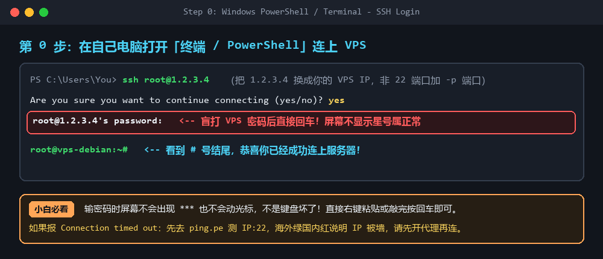
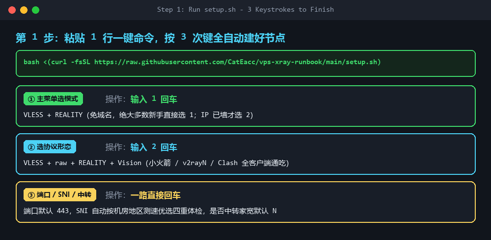
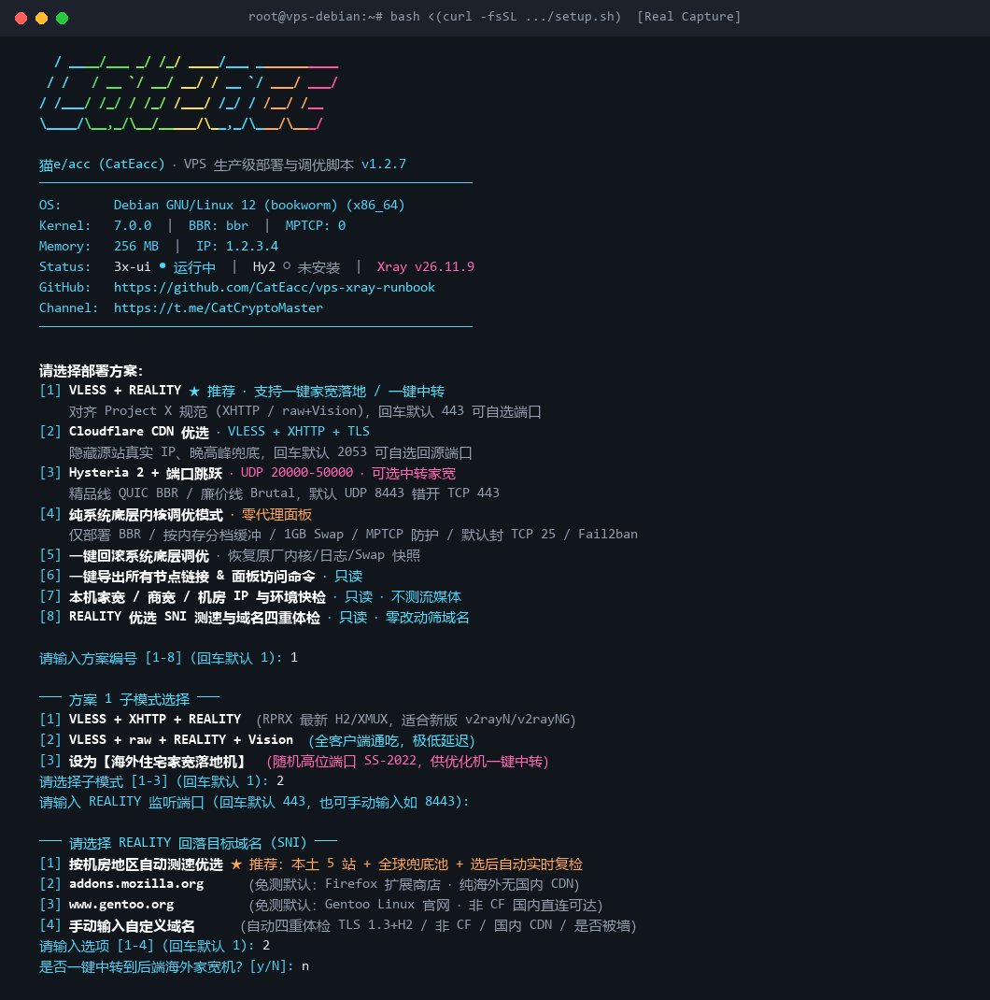
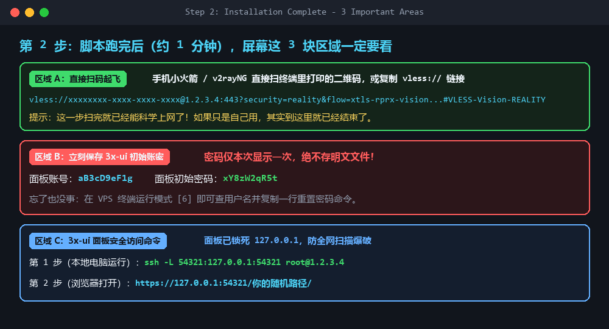
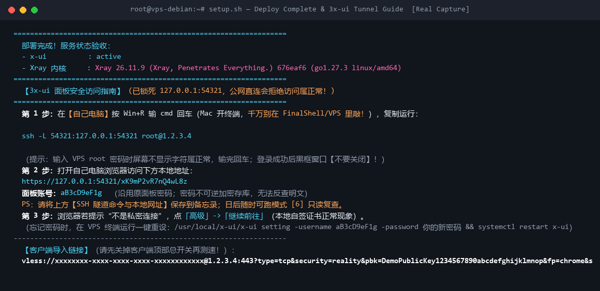
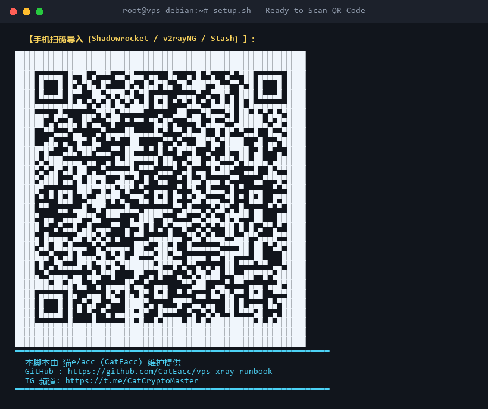
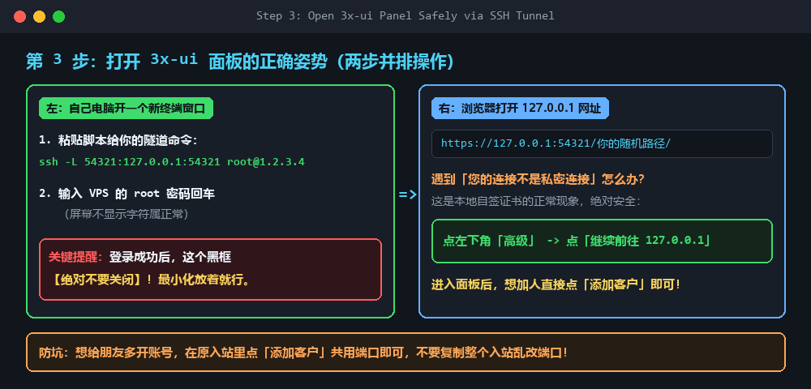
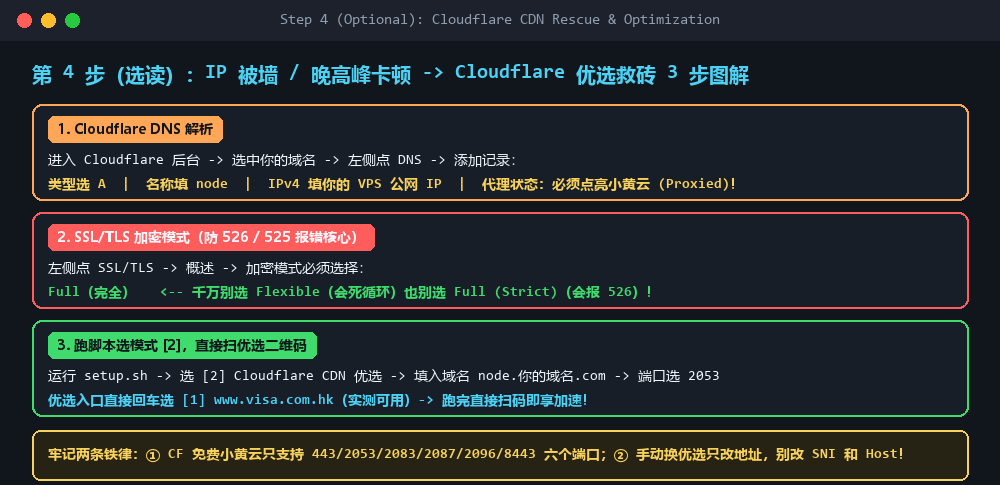

# 零基础纯小白 5 分钟 VPS 搭节点图文保姆教程（无需懂原理，照图点就行）

> **适合人群**：刚买完 VPS、完全不懂 Linux / 网络协议 / 面板配置的新手。  
> **配套脚本**：[`CatEacc/vps-xray-runbook`](https://github.com/CatEacc/vps-xray-runbook)（已自动集成 BBR + fq 加速、内存防 OOM 调优、默认封禁 TCP 25、防扫描加固、REALITY 自动优选 SNI，**不需要再去网上找任何其他 BBR 或 3x-ui 脚本叠加**）。

---

## 开始前：你手里只需要准备好 3 个东西

买完一台海外 VPS（系统推荐 **Debian 12** 或 **Ubuntu 22.04/24.04**）后，去商家后台或开通邮件里找到这 3 项抄下来：

| 信息 | 示例 | 说明 |
| :--- | :--- | :--- |
| **VPS 公网 IP** | `1.2.3.4` | 服务器的地址 |
| **SSH 端口** | `22` | 绝大多数商家默认是 `22`，如果邮件里写了其他数字就用邮件里的 |
| **root 密码** | `Abc123456!` | 服务器的管理员密码 |

---

## 第 0 步：在自己电脑连上 VPS（SSH 登录）

**Windows 电脑**（无需下载任何第三方软件）：按 `Win + X` -> 点 **「终端」** 或 **「Windows PowerShell」**（Mac 电脑直接打开自带的 **「终端」**）。

输入下面这行命令并回车（把 `1.2.3.4` 换成你的 VPS IP；如果端口不是 22，写成 `ssh -p 你的端口 root@1.2.3.4`）：

```bash
ssh root@1.2.3.4
```



> **新手最常卡住的两个瞬间**：
> 1. 第一次连接会问 `Are you sure you want to continue connecting (yes/no)?`，完整输入 **`yes`** 回车。
> 2. 提示输入 `password:` 时，**屏幕完全不会显示 `*` 号，光标也不会动——这不是键盘坏了！** 直接盲打完密码（或在黑框里点鼠标右键粘贴）后直接按回车，看到 `root@xxx:~#` 就成功了。
> 3. 如果卡很久报 **`Connection timed out`**：去 [ping.pe](https://ping.pe) 测一下 `你的IP:22`，如果**海外全绿、国内全红**说明 IP 被墙了，在本地开代理（或用 FinalShell 挂本地代理）就能连上。

---

## 第 1 步：粘贴 1 行一键命令，按 3 下键全自动建好节点

连上 VPS 看到 `root@xxx:~#` 后，复制下面整行命令粘贴进去，按回车：

```bash
bash <(curl -fsSL https://raw.githubusercontent.com/CatEacc/vps-xray-runbook/main/setup.sh)
```

脚本会自动检测你的系统并弹出菜单，**新手照着下面按 3 下键就行**：

> **重要选型提醒（先看自己的 VPS 线路再选方案）**：
> - **有中国大陆回国优化线路的机子**（如 CN2 GIA / 9929 / CMIN2 / 精品日新）：直接选模式 **`[1]` VLESS + REALITY**，直连延迟最低、跑满带宽。
> - **普通廉价机房（如 RackNerd 等没有回国优化的美西普通线路）**：晚高峰直连 REALITY 容易丢包卡顿，**这是机房本身回国线路问题，不是脚本或协议问题**——这类机器强烈建议直接选模式 **`[2]` Cloudflare CDN 优选**（自带企业级优选入口）或模式 **`[3]` Hysteria 2**。

1. 主菜单输入 **`1`** 回车（选 `VLESS + REALITY`，**无需买域名**；如果买的是 RN 等无回国优化廉价机或 IP 已墙，推荐直接选 `2`）。
2. 协议形态输入 **`2`** 回车（选 `VLESS + raw + REALITY + Vision`，小火箭 / v2rayN / Clash 全客户端通吃）。
3. 后面的「监听端口」「优选 SNI」「是否中转海外家宽」**全部直接按回车走默认**即可（脚本会自动按机房地区并发测速、做四重体检挑出最优伪装域名）。



> **Debian 12 实机运行 `setup.sh` 交互过程**：
>
> 

等待约 30 秒 ~ 1 分钟，脚本会自动装好底层 BBR 内核调优、Xray 与 3x-ui 面板。

---

## 第 2 步：扫码导入手机 / 电脑，直接起飞

跑完之后，屏幕上会清晰列出 **3 块核心信息**，对照下图看：



> **部署完成界面 & 终端二维码示例**：
>
> 
>
> 

- **区域 A（直接上网）**：拿出手机打开代理软件，直接扫描终端里打印出来的二维码（或复制那条 `vless://...` 链接导入），**到这一步就已经能直接连上外网了！**
  - **iOS（苹果）**：Shadowrocket（小火箭）-> 点左上角扫码图标
  - **Android（安卓）**：v2rayNG -> 点右上角 `+` -> 扫描二维码 / 从剪贴板导入
  - **Windows（电脑）**：v2rayN -> 复制 `vless://` 链接 -> 回到软件主界面按 `Ctrl + V`
  - **Mac（苹果电脑）**：v2rayN / Clash Verge Rev / Shadowrocket
- **区域 B（立刻保存密码）**：立刻把屏幕打印出来的 **3x-ui 面板初始账号和随机密码** 截图或记到备忘录（为保安全，脚本绝不把明文密码存进硬盘）。
- **区域 C（面板地址）**：如果以后想在网页后台看流量或给朋友加账号，看下面第 3 步。

---

## 第 3 步：如何安全打开 3x-ui 面板 & 给朋友加账号

为了防止你的 VPS 面板被全网扫描器爆破，脚本已经把 3x-ui 面板**锁死在 `127.0.0.1`（仅本机可访）**，不能直接在浏览器里输 `VPS_IP:端口` 打开。

正确打开方式非常简单，**左右两步并排操作**：



1. **左边（本地电脑新开一个黑框终端）**：粘贴安装完成后给你的那行 `ssh -L ...` 命令，输入 VPS root 密码回车登录。**登录成功后，这个黑框窗口千万不要关闭，最小化放一边就行。**
2. **右边（电脑浏览器）**：打开脚本给你的 `https://127.0.0.1:端口/随机路径/`。
   - 浏览器如果提示 **「您的连接不是私密连接」**，这是本地自签证书的正常现象，点左下角 **「高级」 -> 「继续前往 127.0.0.1」**。
   - 输入你刚才保存的面板账号和密码即可登录。

### 面板里最常用的 3 个操作（避坑必看）

- **怎么给朋友多加一个账号（多设备/限制流量）？**
  - 进入左侧 **「入站列表（Inbounds）」** -> 点已经建好的入站展开（或在左侧 **「客户（Clients）」** 点 **「+ 添加客户」**），填个名字和流量上限即可。
  - **千万不要「复制整个入站」再随便改端口！** 同一个端口本来就可以挂几十个客户，共用原端口最稳妥。
- **怎么在同一个端口下，单独开一个走自己「住宅代理 IP」的节点？**
  - 同样**不要复制入站改端口**：先在原入站里点「添加客户」新建一个用户（如 `home-ip`）-> 左侧进 **「出站规则（Outbounds）」** 添加你的 `socks`/`http` 住宅代理（标签如 `my-home`）-> 左侧进 **「路由规则（Routing）」** 加一条「用户 `home-ip` -> 出站 `my-home`」保存重载即可，原节点和新住宅节点互不影响。
- **忘记 3x-ui 面板密码怎么办？**
  - 重新 SSH 连上 VPS，再跑一遍 `setup.sh` 选模式 **`[6]`（一键导出所有节点链接 & 面板访问命令）**，屏幕上会直接显示你的面板用户名，并给出一行可直接复制的一键重置密码命令。

---

## 第 4 步（选读）：IP 被墙 / 晚高峰卡顿 -> Cloudflare CDN 优选救砖

如果你的 VPS IP 不幸被墙了，或者直连晚高峰丢包严重，只需要花 10 块钱买一个托管在 Cloudflare 的域名，照着下面 **3 步** 就能救活并跑出企业级优选速度：



1. **Cloudflare DNS 解析**：进 Cloudflare 后台 -> 选中你的域名 -> 左侧点 **DNS** -> 添加 `A` 记录，名称填 `node`，IPv4 填你的 VPS IP，**代理状态必须点亮小黄云（Proxied）**。
2. **Cloudflare SSL/TLS 加密模式**：左侧点 **SSL/TLS -> 概述**，把加密模式选为 **`Full`（完全）**。
   - 千万不要选 `Flexible`（会 521/死循环），也不要选 `Full (Strict)`（自签证书必报 `526`）。
3. **VPS 跑脚本选模式 `[2]`**：
   - 运行 `setup.sh` -> 选 **`[2] Cloudflare CDN 优选`** -> 输入刚才解析的域名 `node.你的域名.com` -> 监听端口直接回车默认 **`2053`**。
   - 优选入口直接回车选 **`[1] www.visa.com.hk`**（经大陆三网实测可用的企业级入口），脚本跑完会直接打印**已经替你填好优选入口的最终二维码**，扫码即用。

> **Cloudflare 两条铁律**：
> 1. CF 免费版小黄云（HTTPS）只支持固定 6 个端口：**`443`、`2053`、`2083`、`2087`、`2096`、`8443`**，切勿改成其他端口。
> 2. 以后在客户端里手动更换其他优选 IP/域名时，**只能改「服务器地址（Address）」**，下面的 **SNI 和 Host（伪装域名）必须保持你自己的域名不动**，否则会出现“有延迟但打不开任何网页”。

---

## 第 5 步：小白高频报错 1 分钟对照表

| 遇到的问题 | 最可能原因 | 10 秒解决办法 |
| :--- | :--- | :--- |
| **SSH 连不上，报 `Connection timed out` 或 `Connection closed by ... port 22`** | IP 被墙 / 输错密码太多次被 `fail2ban` 封 IP / 电脑梯子连着自己 VPS 套娃 / 安全组没放行 | 先关掉电脑梯子或换个其他节点，或连手机热点换个 IP 再试；去 `ping.pe` 测 `IP:22`（海外绿国内红就挂代理连） |
| **直连 VLESS REALITY 晚高峰很卡、丢包严重** | 廉价普通机房（如 RackNerd）没有中国大陆回国优化线路，属于线路问题而非脚本问题 | 改用模式 **`[2]` Cloudflare CDN 优选**（自带实测企业级入口）或模式 **`[3]` Hysteria 2** |
| **节点测速超时、完全连不上** | 云厂商安全组没放行 `443`（或你选的端口）/ 节点地址误填了 `localhost` | 检查 AWS/阿里云/甲骨文后台安全组放行对应 TCP 端口；检查客户端里服务器地址是不是 VPS 真实公网 IP |
| **测速有延迟，但所有网页都打不开** | CF 端口改成了非白名单端口 / CF SSL 模式没选 `Full` / 换优选时把 SNI 也改了 | 端口改回 `2053` 或 `443`；CF 后台 SSL 选 `Full`；客户端确认 SNI 和 Host 填的是你自己的域名 |
| **手机流量（4G/5G）能用，连家里移动宽带能搜谷歌但点不开结果** | 中国移动宽带 IPv6 丢包，或客户端分流规则没覆盖/DNS 污染 | 先把代理软件切 **「全局模式」** 测试；并在代理软件设置里 **关闭 IPv6**（或关闭路由器 IPv6） |
| **忘了节点链接或 3x-ui 面板地址/密码** | 关掉终端忘截图了 | SSH 连上 VPS 重跑 `setup.sh` 选模式 **`[6]`**（只读导出，零改动），一键找回所有链接和重置密码命令 |
| **跑完这个脚本还需要再装其他 BBR 脚本吗？** | 不需要！ | 脚本已内置原厂 BBR + fq 与分档内存调优，**千万不要叠跑第三方魔改内核/BBR 脚本**，容易覆盖参数导致断流 |

---

如果这份教程帮到了你，欢迎给项目点个 Star：[`CatEacc/vps-xray-runbook`](https://github.com/CatEacc/vps-xray-runbook)。
