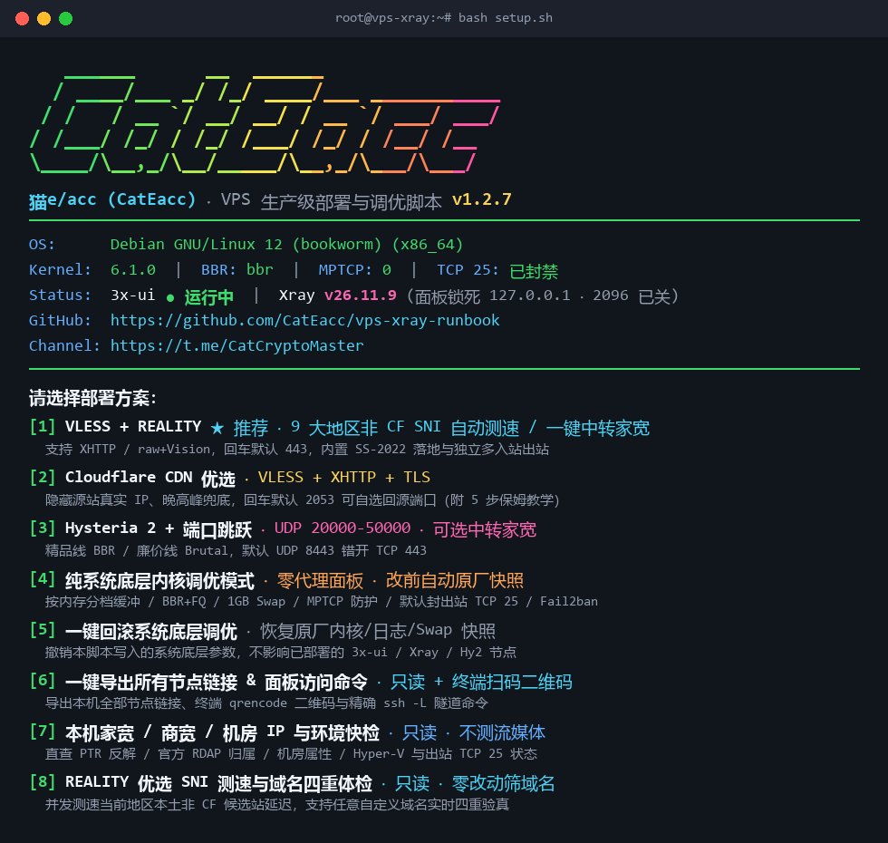

# 生产级 VPS 部署与调优实战手册（Xray v26.11.9 / 3x-ui v3.11.0）

[](https://github.com/XTLS/Xray-core/releases)
[](https://github.com/MHSanaei/3x-ui/releases)
[](LICENSE)
[](https://t.me/CatCryptoMaster)

> **仓库地址**：`github.com/CatEacc/vps-xray-runbook`  
> **定位说明**：本手册采用 `3x-ui` 兼顾可视化管理与生产级安全加固；文中所有 Linux 内核栈参数、Xray 路由模板、REALITY / XHTTP 规范与家宽加固脚本，均与纯 `Xray-core` JSON 部署完全通用。

---

## 小白一键执行（四套方案交互菜单，回车默认端口 / 支持一键中转家宽）

新机直接以 `root` 执行下方一键脚本，按提示输入 `1`～`4` 选择方案（**端口直接回车默认 `443`，也可手动输入任意端口**；默认幂等防重入，面板自动锁死 `127.0.0.1`）：

```bash
bash <(curl -fsSL https://raw.githubusercontent.com/CatEacc/vps-xray-runbook/main/setup.sh)
```



* **方案 1：`VLESS + REALITY`（支持一键中转家宽）**
  * 支持 RPRX 最新 **`XHTTP + REALITY`** 与全客户端通吃的 **`raw + REALITY + xtls-rprx-vision`**，端口回车默认 `443`（也可手填如 `8443` / 高位端口）；
  * 内置 **9 大地区 100% 纯本土 X25519 SNI 自动测速 + 全球 5 站兜底池**（附中文用途说明，零云厂商 / 零银行 / 零运营商 / 零敏感政府站），选中后自动执行 **实时四重复检**（`TLS 1.3 + H2` / 非 CF / 无国内 CDN / 中国大陆可达）；
  * 内置**家宽联动子选项**：既可在海外家宽机上一键生成 `Shadowsocks-2022` 高位落地入站，也可在中国大陆优化机上粘贴家宽信息**一键完成前置中转**（自动写入出站与置顶防回国路由）。
* **方案 2：`Cloudflare CDN 优选`（`VLESS + XHTTP + TLS`）**
  * 默认端口 `2053`（回车即用，支持自定义其他 CF HTTPS 回源端口），自动配置 `XHTTP` 与真实 IP 透传。
* **方案 3：`Hysteria 2`（含 `20000-50000` 端口跳跃，支持一键中转家宽）**
  * 按线路可选标准 **QUIC BBR**（精品优化线）或 **Brutal**（廉价高丢包线）；若同机已跑 `TCP 443 REALITY`，默认错开至 `UDP 8443` 监听（配合端口跳跃，避免同 443 端口返回矛盾证书）。
* **方案 4：`纯系统底层内核调优模式`**
  * 仅部署 BBR / 按内存分档网络缓冲区 / 1GB Swap / MPTCP 防护 / Fail2ban / Chrony 对时 / Journald 50M 收敛，不安装任何代理面板。

---

## 阶段零：顶层架构决策 —— 机房机器（DC） vs 家宽机器（Residential）

在动手部署前，建议先明确机器属于**机房商业 VPS** 还是**原生住宅家宽 VPS**，二者的网络环境与 ISP 策略差异很大。

### 1. 机房机 vs 家宽机 核心属性对比

| 维度 / 特征 | 机房商业机器（DC / Cloud VPS）<br>*(例：DMIT / AWS / RackNerd / BandwagonHOST)* | 原生家庭宽带机器（Residential VPS）<br>*(例：AT&T / Spectrum 等住宅 ISP)* |
| :--- | :--- | :--- |
| **IP 纯净度与风控** | 机房 ASN（Hosting/DataCenter），较易触发流媒体 / AI 服务 / 银行风控或验证码。 | **原生住宅 ISP**，流媒体与风控信任度极高。 |
| **国际线路质量** | 可选 CN2 GIA / 9929 / CMIN2 / BGP 优质骨干网，晚高峰低延迟、低丢包。 | 普通民用国际互联，晚高峰跨洋丢包率可能达 20%~40%，无回国线路优化。 |
| **入站 80 / 443 端口** | **通常完全开放**，具备标准 Web 承载能力。 | [注意] **多数民用 ISP 阻断或受限**（屏蔽 80，部分光猫防火墙拦截 443）。 |
| **端口选型建议** | 有独立 IP 且 443 空闲时**优先推荐 `443`**（最贴近常规 HTTPS 行为）；若 443 被占或为 NAT 机，自定义端口（如 `8443` / `2053` / 高位端口）同样可行。 | **避开 80 / 443**，推荐使用 **10000～60000 的随机高位端口**。 |
| **在架构中的最佳定位** | **【前置迎宾机 / 链式中转站】**<br>利用优质回国线路承载 REALITY / XHTTP / Hy2 吞吐。 | **【后端纯净落地机 / 住宅出口】**<br>仅放行前置中转机连入，不向公网裸露。 |

---

### 2. 【机房机器】标准执行思路

* **核心目标**：发挥 BGP / 优化线路速度，通过标准 HTTPS 伪装（REALITY / XHTTP）或 CDN 隐藏源站。
* **执行步骤**：
  1. **系统底层优化**：1GB Swap 气囊、`net.mptcp.enabled = 0`、BBR + 按内存分档读写缓冲区、IPv4 优先。
  2. **外部安全组**：AWS / 阿里云 / 腾讯云等需在控制台安全组放行对应 TCP 端口（使用 Hy2 端口跳跃时另放行对应 UDP 端口段）。
  3. **协议配置**：
     * **方案 1（纯 TCP/H2 稳态）**：**VLESS + REALITY**（推荐 `raw + xtls-rprx-vision` 或 `xhttp`），优先推荐 `443` 端口（亦可自定义）；
     * **方案 2（CDN 隐身 / 晚高峰兜底）**：**VLESS + XHTTP + TLS**（监听 `2053` 等 CF 支持端口），套 Cloudflare Anycast；
     * **方案 3（弱网抗丢包）**：**Hysteria 2** + `20000-50000` 端口跳跃（若同机已跑 TCP 443 REALITY，建议 Hy2 错开监听如 UDP `8443`）。
  4. **管理安全**：面板锁死 `127.0.0.1`，通过 `~/.ssh/config` 本地端口转发（`LocalForward`）访问。

---

### 3. 【家宽机器】标准执行思路

* **核心目标**：保护原生住宅 IP 纯净度，绕开民用 ISP 端口限制，作为后端纯净落地出口。
* **执行步骤**：
  1. **系统底层优化**：同机房机（Swap、BBR、日志收敛、`net.mptcp.enabled = 0`）。
  2. **端口选型**：避开 `80` / `443`（AT&T / Spectrum / Cox 等民用 ISP 普遍拦截），选用 **10000～60000 随机高位端口**（如 `20001`、`30001`、`40001`）。
  3. **定位为后端落地**：在落地机部署 **Shadowsocks-2022 (`2022-blake3-aes-256-gcm`)** 或 VLESS，配合 `nftables` 仅放行前置中转机 IP 连入。
  4. **驻地真家宽（家用光猫 `/26` 合租 + Windows Hyper-V 母鸡）专项加固**（详见阶段四第 4 节）：
     * 出口拒 `UDP 443`（QUIC）保护光猫 `8,192` 状态表防首包 `1000ms` 重传；关闭 Hyper-V 虚拟网卡有缺陷的 `GRO` 合包；按需屏蔽 `hv_balloon` 防母鸡抽内存。

---

## 阶段一：系统底层、内存保命与高并发内核

### 1. 基础环境、原子钟对时、Swap 保命与日志限额
```bash
# 1. 软件更新与依赖安装
export DEBIAN_FRONTEND=noninteractive
apt update -y && apt upgrade -y && apt install -y curl wget unzip chrony iptables nftables iptables-persistent sqlite3 fail2ban python3 python3-systemd

# 2. 原子钟同步（解决 REALITY maxTimeDiff / Hy2 握手时间差导致的拒连）
systemctl enable --now chrony
chronyc makestep || true
timedatectl set-timezone Asia/Shanghai 2>/dev/null || true
systemctl restart cron 2>/dev/null || true

# 3. 创建 1GB Swap（512M / 1G 小内存防 OOM 气囊，若云镜像自带不足 900M 的 /swap.img 则平滑替换）
if [ ! -f /swapfile ]; then
    fallocate -l 1G /swapfile || dd if=/dev/zero of=/swapfile bs=1M count=1024
    chmod 600 /swapfile
    mkswap /swapfile
    swapon /swapfile || true
fi
grep -q "/swapfile" /etc/fstab || echo "/swapfile none swap sw 0 0" >> /etc/fstab
if [ -f /swap.img ] && [ "$(stat -c%s /swap.img 2>/dev/null || echo 1073741824)" -lt 943718400 ]; then
    swapoff /swap.img 2>/dev/null || true
    sed -i '\|/swap\.img|d' /etc/fstab
    rm -f /swap.img
fi

# 4. 日志上限与内存映射收敛（防写爆小硬盘 + 杜绝 journald 映射百兆日志占用物理内存）
cat << 'EOF' > /etc/systemd/journald.conf
[Journal]
SystemMaxUse=50M
SystemMaxFileSize=10M
RuntimeMaxUse=20M
MaxRetentionSec=7day
ForwardToSyslog=no
EOF
systemctl restart systemd-journald 2>/dev/null || true
journalctl --rotate 2>/dev/null || true
journalctl --vacuum-size=40M >/dev/null 2>&1 || true

# 4.1 配置 3x-ui 日志自动轮转
cat << 'EOF' > /etc/logrotate.d/x-ui
/var/log/x-ui/*.log {
    weekly
    size 2M
    rotate 2
    compress
    missingok
    notifempty
    copytruncate
}
EOF

# 4.5 关闭后台 apt-daily / unattended-upgrades 防 512M/1G 小鸡突发内存尖峰 OOM
systemctl disable --now apt-daily.timer apt-daily-upgrade.timer unattended-upgrades.service 2>/dev/null || true
apt-get clean >/dev/null 2>&1 || true

# 5. IPv4 出站优先 + DNS 1秒快速故障切换
if [ -f /etc/gai.conf ]; then
    sed -i '/^precedence ::ffff:0:0\/96\s\+100/d' /etc/gai.conf
    echo "precedence ::ffff:0:0/96  100" >> /etc/gai.conf
fi
if [ ! -L /etc/resolv.conf ] && [ -f /etc/resolv.conf ]; then
    sed -i '/^options /d' /etc/resolv.conf
    if [ -z "$(ip -6 addr show scope global 2>/dev/null | grep inet6)" ]; then
        sed -i '/^nameserver .*:/d' /etc/resolv.conf
    fi
    echo "options timeout:1 attempts:2" >> /etc/resolv.conf
elif systemctl is-active --quiet systemd-resolved 2>/dev/null; then
    mkdir -p /etc/systemd/resolved.conf.d
    printf "[Resolve]\nDNS=1.1.1.1 8.8.8.8\nFallbackDNS=1.0.0.1 9.9.9.9\n" > /etc/systemd/resolved.conf.d/99-fast-dns.conf
    systemctl restart systemd-resolved 2>/dev/null || true
fi

# 6. SSH 公钥免密放行 + 已配公钥时自动关闭密码防爆破
sed -i 's/^#*PubkeyAuthentication.*/PubkeyAuthentication yes/' /etc/ssh/sshd_config
sed -i 's/^#*PubkeyAuthentication.*/PubkeyAuthentication yes/' /etc/ssh/sshd_config.d/*.conf 2>/dev/null || true
grep -q "^PubkeyAuthentication yes" /etc/ssh/sshd_config || echo "PubkeyAuthentication yes" >> /etc/ssh/sshd_config
if [ -s /root/.ssh/authorized_keys ] || [ -s ~/.ssh/authorized_keys ] || { [ -n "${SUDO_USER:-}" ] && [ -s "/home/${SUDO_USER}/.ssh/authorized_keys" ]; }; then
    sed -i 's/^#*PasswordAuthentication.*/PasswordAuthentication no/' /etc/ssh/sshd_config
    sed -i 's/^#*PasswordAuthentication.*/PasswordAuthentication no/' /etc/ssh/sshd_config.d/*.conf 2>/dev/null || true
    grep -q "^PasswordAuthentication no" /etc/ssh/sshd_config || echo "PasswordAuthentication no" >> /etc/ssh/sshd_config
fi
sshd -t && (systemctl restart ssh 2>/dev/null || systemctl restart sshd 2>/dev/null || true)

# 6.5 部署 Fail2ban 24小时+累犯翻倍拉黑（动态探测 SSH 端口 + aggressive 模式）
apt install -y fail2ban iptables nftables python3-systemd >/dev/null 2>&1 || true
SSH_PORTS=$(sshd -T 2>/dev/null | awk '$1=="port"{print $2}' | paste -sd, -)
SSH_PORTS=${SSH_PORTS:-22}
cat << EOF > /etc/fail2ban/jail.local
[DEFAULT]
bantime = 86400
bantime.increment = true
bantime.factor = 2
bantime.maxtime = 2592000
findtime = 600
maxretry = 3
backend = systemd

[sshd]
enabled = true
port = $SSH_PORTS
mode = aggressive
EOF
systemctl enable --now fail2ban && systemctl restart fail2ban
truncate -s 0 /var/log/btmp 2>/dev/null || true
rm -f /var/log/btmp.* 2>/dev/null || true
```

### 2. 高并发网络内核栈（按内存分档热加载，0 宕机）
```bash
# 开机预加载 BBR 与连接跟踪内核模块
mkdir -p /etc/modules-load.d
printf "tcp_bbr\nnf_conntrack\n" > /etc/modules-load.d/99-proxy.conf
modprobe tcp_bbr 2>/dev/null || true
modprobe nf_conntrack 2>/dev/null || true

# 按物理内存自动分三档计算网络缓冲区（<=700M 防 OOM，1G 均衡，2G+ 高吞吐）
MEM_MB=$(free -m | awk '/Mem:/ {print $2}')
if [ "${MEM_MB:-1000}" -le 700 ]; then
    RMEM_MAX=16777216; TCP_MAX=8388608; DEF_BUF=262144; CONN_MAX=65536
elif [ "${MEM_MB:-1000}" -lt 1500 ]; then
    RMEM_MAX=33554432; TCP_MAX=16777216; DEF_BUF=524288; CONN_MAX=65536
else
    RMEM_MAX=67108864; TCP_MAX=33554432; DEF_BUF=1048576; CONN_MAX=131072
fi

# 文件名必须用 99-zzz-* 字典序垫底，防止重启时被系统自带的 /usr/lib/sysctl.d/99-sysctl.conf 覆盖
rm -f /etc/sysctl.d/99-network-tuning.conf /etc/sysctl.d/99-proxy-tuning.conf* /etc/sysctl.d/99-bbr-network.conf
cat << EOF > /etc/sysctl.d/99-zzz-proxy-tuning.conf
# [拥塞控制] 公平队列调度 (FQ) + Google BBR
net.core.default_qdisc = fq
net.ipv4.tcp_congestion_control = bbr

# [安全防御] 禁用 Linux 内核 MPTCP（Project X v26.10.31 安全更新：防范 IPv4 MPTCP 提权攻击面，建议同步更新宿主机内核）
-net.mptcp.enabled = 0

# [队列扩容]
net.core.somaxconn = 32768
net.core.netdev_max_backlog = 16384
net.ipv4.tcp_max_syn_backlog = 16384

# [出站端口扩充与 TIME_WAIT 复用（提升中转出站并发）]
net.ipv4.ip_local_port_range = 10000 65535
net.ipv4.tcp_tw_reuse = 1
net.ipv4.tcp_fin_timeout = 15
net.ipv4.tcp_keepalive_time = 300
net.ipv4.tcp_keepalive_intvl = 30
net.ipv4.tcp_keepalive_probes = 3
net.ipv4.tcp_max_tw_buckets = 262144

# [跨洋链路优化] 关闭空闲慢启动、开启 PMTU 探测、禁用劣化缓存、关闭 ECN
net.ipv4.tcp_slow_start_after_idle = 0
net.ipv4.tcp_mtu_probing = 1
net.ipv4.tcp_no_metrics_save = 1
net.ipv4.tcp_ecn = 0

# [按内存分档缓冲区]
net.core.rmem_max = $RMEM_MAX
net.core.wmem_max = $RMEM_MAX
net.core.rmem_default = $DEF_BUF
net.core.wmem_default = $DEF_BUF
net.ipv4.udp_rmem_min = 16384
net.ipv4.udp_wmem_min = 16384
net.ipv4.tcp_rmem = 4096 87380 $TCP_MAX
net.ipv4.tcp_wmem = 4096 65536 $TCP_MAX

# [握手与低延迟]
net.ipv4.tcp_fastopen = 3
net.ipv4.tcp_notsent_lowat = 16384
net.ipv4.tcp_adv_win_scale = 1

# [连接跟踪防满表]
-net.netfilter.nf_conntrack_max = $CONN_MAX
-net.netfilter.nf_conntrack_udp_timeout = 30
-net.netfilter.nf_conntrack_udp_timeout_stream = 60

# [流量转发、句柄上限与 Swap 策略]
net.ipv4.ip_forward = 1
fs.file-max = 2097152
vm.swappiness = 10
EOF

grep -vE '^\s*#|^\s*$' /etc/sysctl.d/99-zzz-proxy-tuning.conf | sed 's/^-//' | while IFS='=' read -r k v; do
    sysctl -w "$(echo "$k" | xargs)=$(echo "$v" | xargs)" >/dev/null 2>&1 || true
done

sysctl net.ipv4.tcp_congestion_control net.mptcp.enabled

# 解锁单进程 100 万句柄 + 崩溃无限自愈 + OOM 保护 + 启动前原子清理 3x-ui 历史监控缓存
cat << 'EOF' > /etc/security/limits.d/99-nofile.conf
* soft nofile 1048576
* hard nofile 1048576
root soft nofile 1048576
root hard nofile 1048576
EOF
mkdir -p /etc/systemd/system/x-ui.service.d /etc/systemd/system/hysteria-server.service.d
cat << 'EOF' > /etc/systemd/system/x-ui.service.d/limits.conf
[Unit]
StartLimitIntervalSec=0

[Service]
LimitNOFILE=1048576
Restart=always
RestartSec=3s
OOMScoreAdjust=-500
ExecStartPre=-/bin/rm -f /etc/x-ui/system_metrics.gob
EOF
cat << 'EOF' > /etc/systemd/system/hysteria-server.service.d/limits.conf
[Unit]
StartLimitIntervalSec=0

[Service]
LimitNOFILE=1048576
Restart=always
RestartSec=3s
OOMScoreAdjust=-500
EOF
systemctl daemon-reload
```

---

## 阶段二：3x-ui（v3.11.0）部署与 Xray 最新内核（v26.11.9）锁定

> **为何升级至 Xray v26.11.9**：
> - **`v26.10.21`**：移除被破解的印度问题中间证书对应根证书，以 Go 1.27.3 编译过滤；
> - **`v26.10.31`**：针对 Linux 内核 IPv4 MPTCP 漏洞默认关闭 MPTCP，与阶段一 `net.mptcp.enabled = 0` 形成双保险；
> - **`v26.11.9`**：默认 uTLS 指纹升级至 **Chrome 155+**，并包含最新 XHTTP / XDRIVE 优化。

### 3. 一键安装 3x-ui v3.11.0 并锁定 Xray v26.11.9
```bash
# 1. 安装 3x-ui v3.11.0
bash <(curl -Ls https://raw.githubusercontent.com/MHSanaei/3x-ui/master/install.sh) v3.11.0

# 2. 锁定 Xray v26.11.9（按架构下载，先校验 version 再原子替换并同步 geoip/geosite）
systemctl stop x-ui
rm -f /usr/local/x-ui/bin/*.bak
ARCH=$(uname -m)
if [ "$ARCH" = "x86_64" ]; then
    XRAY_ARCH="64"; XRAY_BIN="/usr/local/x-ui/bin/xray-linux-amd64"
else
    XRAY_ARCH="arm64-v8a"; XRAY_BIN="/usr/local/x-ui/bin/xray-linux-arm64"
fi
mkdir -p /tmp/xray-install
curl -fsSL -o /tmp/xray-install/xray.zip "https://github.com/XTLS/Xray-core/releases/download/v26.11.9/Xray-linux-${XRAY_ARCH}.zip"
python3 -m zipfile -e /tmp/xray-install/xray.zip /tmp/xray-install/
chmod +x /tmp/xray-install/xray
/tmp/xray-install/xray version | grep -q "26.11.9"
cp -f /tmp/xray-install/xray "${XRAY_BIN}.new" && chmod +x "${XRAY_BIN}.new" && mv -f "${XRAY_BIN}.new" "$XRAY_BIN"
cp -f /tmp/xray-install/geoip.dat /usr/local/x-ui/bin/geoip.dat 2>/dev/null || true
cp -f /tmp/xray-install/geosite.dat /usr/local/x-ui/bin/geosite.dat 2>/dev/null || true
rm -rf /tmp/xray-install
systemctl start x-ui

# 3. 10 年期 127.0.0.1 本地面板证书（仅在缺失时生成）
if [ ! -f /etc/x-ui/panel_local.key ] || [ ! -f /etc/x-ui/panel_local.crt ]; then
    openssl req -x509 -newkey ec -pkeyopt ec_paramgen_curve:prime256v1 -days 3650 -nodes \
      -keyout /etc/x-ui/panel_local.key -out /etc/x-ui/panel_local.crt \
      -subj "/CN=127.0.0.1" -addext "subjectAltName=IP:127.0.0.1" 2>/dev/null
fi
chmod 700 /etc/x-ui && chmod 600 /etc/x-ui/panel_local.key && chmod 644 /etc/x-ui/panel_local.crt

# 4. 注入 connIdle 空闲回收、bufferSize 收敛、置顶防私网/BT/回国流量、全入站 routeOnly 嗅探与面板锁死 127.0.0.1
XRAY_BUF=$([ "$(free -m | awk '/Mem:/ {print $2}')" -le 700 ] && echo 32 || echo 64) python3 - << 'EOF'
import sqlite3, json, os

db_path = '/etc/x-ui/x-ui.db'
conn = sqlite3.connect(db_path)
c = conn.cursor()

row = c.execute("SELECT value FROM settings WHERE key='xrayTemplateConfig'").fetchone()
if row and row[0]:
    cfg = json.loads(row[0])
else:
    try:
        cfg = json.load(open('/usr/local/x-ui/bin/config.json'))
    except Exception:
        cfg = {}

cfg['log'] = {
    "access": "none",
    "dnsLog": False,
    "error": "",
    "loglevel": "warning",
    "maskAddress": ""
}

# 仅保留 3x-ui 内部 gRPC API 入站（port 62789）
cfg['inbounds'] = [{
    "listen": "127.0.0.1",
    "port": 62789,
    "protocol": "dokodemo-door",
    "settings": {"address": "127.0.0.1"},
    "tag": "api"
}]

lvl0 = cfg.setdefault('policy', {}).setdefault('levels', {}).setdefault('0', {})
lvl0.pop('udpTimeout', None)
lvl0.update({
    'handshake': 4, 'connIdle': 120, 'uplinkOnly': 2, 'downlinkOnly': 5,
    'bufferSize': int(os.environ.get('XRAY_BUF', '64')),
    'statsUserUplink': True, 'statsUserDownlink': True, 'statsUserOnline': True
})

outbounds = cfg.setdefault('outbounds', [])
if not outbounds:
    outbounds.append({"protocol": "freedom", "settings": {"domainStrategy": "UseIPv4"}, "tag": "direct"})
else:
    for ob in outbounds:
        if ob.get('protocol') == 'freedom':
            ob.setdefault('settings', {})['domainStrategy'] = 'UseIPv4'
if not any(ob.get('tag') == 'blocked' for ob in outbounds):
    outbounds.append({"protocol": "blackhole", "settings": {}, "tag": "blocked"})

old_rules = cfg.setdefault('routing', {}).setdefault('rules', [])
custom_rules = [
    r for r in old_rules
    if not (r.get('outboundTag') == 'api' and r.get('inboundTag') == ['api'])
    and not (r.get('outboundTag') == 'blocked' and set(r.get('ip', [])) <= {'geoip:private', 'geoip:cn'} and set(r.get('domain', [])) <= {'geosite:cn'} and not r.get('protocol') and not r.get('inboundTag') and not r.get('user'))
    and not (r.get('outboundTag') == 'blocked' and r.get('protocol') == ['bittorrent'] and not r.get('ip') and not r.get('domain'))
]

# IPOnDemand：在命中 IP 规则时按需解析，确保前置中转机不会因末尾 inboundTag 规则而跳过 geoip:cn/private 拦截
cfg.setdefault('routing', {})['domainStrategy'] = 'IPOnDemand'
cfg['routing']['rules'] = [
    {'type': 'field', 'inboundTag': ['api'], 'outboundTag': 'api'},
    {'type': 'field', 'outboundTag': 'blocked', 'ip': ['geoip:private']},
    {'type': 'field', 'outboundTag': 'blocked', 'protocol': ['bittorrent']},
    {'type': 'field', 'outboundTag': 'blocked', 'ip': ['geoip:cn']},
] + custom_rules

for inb_id, sniff_raw, stream_raw in c.execute("SELECT id, sniffing, stream_settings FROM inbounds").fetchall():
    sn = json.loads(sniff_raw or '{}')
    sn.update({'enabled': True, 'destOverride': ['http', 'tls', 'quic', 'fakedns'], 'metadataOnly': False, 'routeOnly': True})
    c.execute("UPDATE inbounds SET sniffing=? WHERE id=?", (json.dumps(sn), inb_id))
    st = json.loads(stream_raw or '{}')
    so = st.setdefault('sockopt', {})
    so['tcpKeepAliveIdle'] = 120
    so['tcpKeepAliveInterval'] = 20
    c.execute("UPDATE inbounds SET stream_settings=? WHERE id=?", (json.dumps(st, indent=2), inb_id))

for k, v in [
    ('xrayTemplateConfig', json.dumps(cfg, indent=2)),
    ('webListen', '127.0.0.1'),
    ('webCertFile', '/etc/x-ui/panel_local.crt'),
    ('webKeyFile', '/etc/x-ui/panel_local.key'),
]:
    c.execute("DELETE FROM settings WHERE key=?", (k,))
    c.execute("INSERT INTO settings (key, value) VALUES (?, ?)", (k, v))

conn.commit()
conn.execute("VACUUM")
conn.close()
EOF

# 5. 清理裸 IP 证书续签任务 + 配置 [3x-ipl] Fail2ban（显式关闭 bantime.increment 避免误伤正常用户）
rm -rf /root/cert/ip /root/.acme.sh/[0-9]*.[0-9]*.[0-9]*.[0-9]* /var/log/x-ui/access.log 2>/dev/null || true
crontab -l 2>/dev/null | grep -v "/root/cert/ip" | crontab - 2>/dev/null || true
chmod 700 /etc/x-ui
mkdir -p /var/log/x-ui /etc/fail2ban/filter.d /etc/fail2ban/action.d /etc/fail2ban/jail.d
touch /var/log/x-ui/3xipl.log /var/log/x-ui/3xipl-banned.log
SSH_PORTS=$(sshd -T 2>/dev/null | awk '$1=="port"{print $2}' | paste -sd, -)
SSH_PORTS=${SSH_PORTS:-22}
PANEL_PORT=$(python3 -c "import sqlite3; r=sqlite3.connect('/etc/x-ui/x-ui.db').execute(\"SELECT value FROM settings WHERE key='webPort' LIMIT 1\").fetchone(); print(r[0].strip() if r and r[0] else '')" 2>/dev/null | tr -dc '0-9')
EXEMPT_PORTS="${SSH_PORTS}${PANEL_PORT:+,$PANEL_PORT}"
cat << 'EOF' > /etc/fail2ban/filter.d/3x-ipl.conf
[Definition]
datepattern = ^%%Y/%%m/%%d %%H:%%M:%%S
failregex   = \[LIMIT_IP\]\s*Email\s*=\s*<F-USER>.+</F-USER>\s*\|\|\s*Disconnecting OLD IP\s*=\s*<ADDR>\s*\|\|\s*Timestamp\s*=\s*\d+
ignoreregex =
EOF
cat << 'EOF' > /etc/fail2ban/action.d/3x-ipl.conf
[INCLUDES]
before = iptables-allports.conf

[Definition]
actionstart = <iptables> -N f2b-<name>
              <iptables> -A f2b-<name> -j <returntype>
              <iptables> -I <chain> -j f2b-<name>
actionstop = <iptables> -D <chain> -j f2b-<name>
             <actionflush>
             <iptables> -X f2b-<name>
actioncheck = <iptables> -n -L <chain> | grep -q 'f2b-<name>[ \t]'
actionban = <iptables> -I f2b-<name> 1 -s <ip> -p tcp -m multiport ! --dports <exemptports> -j <blocktype>
            <iptables> -I f2b-<name> 1 -s <ip> -p udp -m multiport ! --dports <exemptports> -j <blocktype>
            echo "$(date +"%%Y/%%m/%%d %%H:%%M:%%S")   BAN   [Email] = <F-USER> [IP] = <ip> banned for <bantime> seconds." >> /var/log/x-ui/3xipl-banned.log
actionunban = <iptables> -D f2b-<name> -s <ip> -p tcp -m multiport ! --dports <exemptports> -j <blocktype>
              <iptables> -D f2b-<name> -s <ip> -p udp -m multiport ! --dports <exemptports> -j <blocktype>
              echo "$(date +"%%Y/%%m/%%d %%H:%%M:%%S")   UNBAN   [Email] = <F-USER> [IP] = <ip> unbanned." >> /var/log/x-ui/3xipl-banned.log
[Init]
name = default
chain = INPUT
EOF
printf "exemptports = %s\n" "$EXEMPT_PORTS" >> /etc/fail2ban/action.d/3x-ipl.conf
cat << 'EOF' > /etc/fail2ban/jail.d/3x-ipl.conf
[3x-ipl]
enabled=true
backend=auto
filter=3x-ipl
action=3x-ipl
logpath=/var/log/x-ui/3xipl.log
maxretry=1
findtime=32
bantime=30m
bantime.increment=false
EOF
systemctl restart fail2ban 2>/dev/null || true
systemctl restart x-ui
```

> [注意] **核心排错备忘**：
> 1. **`exit status 23`**：`xrayTemplateConfig` 的 `inbounds` 只能保留 `127.0.0.1:62789` 的 `api` 入站（不能留空 `[]`，否则全员 Offline；也不能含业务入站，否则与数据库冲突）。
> 2. **为何境外服务端不建议封 `geosite:cn`**：v2fly `geosite:cn` 包含 `google@cn`（如 `dl.google.com`）与 `apple@cn`，封锁会导致 Google Play 卡“等待下载”。仅拦截 `ip: ["geoip:cn"]` + `domainStrategy: "IPOnDemand"` 即可在命中 IP 规则时按需解析拦截回国流量（注：`IPOnDemand` 会略微增加首次连接 DNS 解析开销，但可避免中转机被末尾 `inboundTag` 规则跳过 IP 拦截）。
> 3. **防 `system_metrics.gob` 内存膨胀**：在 `x-ui.service.d/limits.conf` 中用 `ExecStartPre=-/bin/rm -f /etc/x-ui/system_metrics.gob` 原子清理折线图缓存（不影响 `x-ui.db` 流量账本）。
> 4. **全入站 `sniffing.routeOnly: true`**：开启协议嗅探才能识别 BT 下载（保护住宅 IP 免受 DMCA 投诉），同时 `routeOnly: true` 保证不篡改目标 IP。

---

## 阶段三：三大主力协议配置规范（对齐 Project X 官方推荐）

### 方案 1：`VLESS + REALITY`（`XHTTP + REALITY` 或 `raw + REALITY + Vision`）
* **定位**：无需自备域名与证书，消除服务端 TLS 指纹且免疫证书链攻击，纯 TCP/H2 免疫运营商 UDP QoS。
* **严格对齐 `XTLS/REALITY` 官方规范**：
  1. **两种推荐组合（严禁裸跑 TLS-in-TLS）**：
     * **组合 A（全客户端通吃、极致低延迟）**：`network: "raw"` + `security: "reality"` + **`flow: "xtls-rprx-vision"`**（抹平 TLS-in-TLS 特征，v2rayN / Shadowrocket / Mihomo / sing-box 全支持）；
     * **组合 B（最新 H2/XMUX 抗特征）**：`network: "xhttp"` + `security: "reality"`（`flow` 留空，`xhttpSettings` 保持极简 `path` + `mode: "auto"`，适配最新版 Xray-core 客户端）。
  2. **端口选型**：
     * 有独立 IP 且 443 空闲时**优先推荐 `443`**（最贴近常规 HTTPS 服务，有条件还可将 TCP/80 与 UDP/443 一并转发至同一目标站）；
     * 若 `443` 被占用、NAT 共享 IP、或家宽受 ISP 限制，**自由选用 `8443` / `2053` 或随机高位端口完全可行**（一键脚本支持回车默认 `443`，也可手填任意端口）。
  3. **目标网站（`target` / `serverNames`）选型标准**：
     * 最低标准：**国外网站、支持 TLSv1.3 与 H2、域名非跳转用**（如主域名 301 跳转 `www.`，则直接填 `www.`）；
     * 加分项：与 VPS 地理位置/IP 相近、支持 OCSP Stapling、**服务端禁回国流量**。
  4. **进阶加固**：可选通过 `./xray mldsa65` 生成 `mldsa65Seed` / `mldsa65Verify` 进行抗量子额外签名；遵循官方建议不随意启用 `limitFallbackUpload/Download` 回落限速。

---

### 方案 2：Cloudflare CDN 优选（推荐 `VLESS + XHTTP + TLS`，默认 `2053` 端口）
* **定位**：晚高峰抗拥堵兜底、彻底隐藏源站真实 IP。
* **协议选型**：
  * **首选 `XHTTP`（`network: "xhttp"`）**：采用标准 HTTP/2 语义 + XMUX 多路复用与随机填充，全面取代传统 WebSocket（`xhttpSettings` 仅配 `path` + `mode: "auto"`）；
  * **兼容备选 `WS`**：仅在需兼容不支持 XHTTP 的老旧/第三方客户端时使用。
* **证书与安全规范**：
  * **优先推荐**使用 `acme.sh` 或 Cloudflare Origin Certificate 配置正规证书，Cloudflare 后台 **SSL/TLS** 设为 **`Full (Strict)`**；
  * 仅在临时使用自签证书时将 Cloudflare 设为 `Full`，客户端始终通过域名验证 Cloudflare 边缘正规证书，**绝不开启无约束的 `allowInsecure: true`**（Xray v26.2.6+ 已强制限制）。
* **客户端导入示例**：
  ```text
  vless://<UUID>@<优选域名或IP>:2053?type=xhttp&mode=auto&security=tls&path=%2Fvless-xhttp&host=cf.example.com&sni=cf.example.com#CF-XHTTP-优选
  ```

---

### 方案 3：`Hysteria 2` + `20000-50000` 端口跳跃
* **定位**：利用 QUIC 加密与 30,000 端口跳跃应对单 UDP 端口 QoS 限速。
* **同机端口错开原则（防主动探测矛盾）**：
  * Linux 允许 `TCP 443` 与 `UDP 443` 同时监听；但若同机 `TCP 443` 已跑 REALITY（返回目标大厂真证书），建议 **Hysteria 2 错开监听其他 UDP 端口（如 `UDP 8443`）**，再由 `20000-50000` 跳跃重定向至 `8443`——避免同一 IP 的 `443` 端口在 TCP 与 UDP 上返回两个互相矛盾的证书。
* **证书与拥塞控制规范**：
  * **有域名优先用 `acme.sh` 申请正规免费证书**（无需 `insecure=1` 与 `sniGuard: disable`；续期 `--reloadcmd` 记得给 `hysteria` 用户授读取权限）；
  * **无域名仅用自签证书时**：服务端配 `sniGuard: disable`，客户端必须同时携带 **`insecure=1` 与 `pinSHA256=<指纹>`**（以指纹锁定防中间人）；
  * **按线路选拥塞算法**：CN2 GIA / 9929 / CMIN2 精品线设 `ignoreClientBandwidth: true`（温和标准 QUIC BBR）；普通高丢包直连线可设 `false` 开启 Brutal。

---

## 阶段四：中国大陆优化机一键中转海外家宽落地架构

**链路**：国内客户端 -> **前置优化机（REALITY / XHTTP / Hy2）** -> **后端住宅家宽（Shadowsocks-2022 `2022-blake3-aes-256-gcm`）** -> **原生住宅宽带出口**。

1. **两步一键完成（直接使用顶部 `setup.sh` 方案 1）**：
   * **第 1 步（在家宽落地机上运行）**：选 `方案 1` -> 子菜单选 **`配置为后端家宽落地机（SS-2022）`**，脚本自动在随机高位端口创建 Shadowsocks-2022 入站、生成 32 字节 Base64 密钥并打印中转凭据（可选自动挂载 `nftables` 源 IP 白名单）。
   * **第 2 步（在中国大陆优化机上运行）**：选 `方案 1`（或 `方案 3` Hy2） -> 询问是否中转后端家宽时选 `y`，粘贴刚才的 `家宽IP`、`端口`、`SS-2022 密钥`，脚本自动写入 `out-residential` 出站、置顶 `geoip:cn/private/bt` 熔断规则并输出客户端导入链接。
2. **Hy2 走本地 SOCKS5 中转的省内存铁律**：
   * 若 Hy2 通过 `127.0.0.1:10855` 转发给本机 Xray，因 Xray 已加载 `geoip.dat`，512M/1G 小内存机器应删掉 Hy2 配置中的 `geoip.dat` 与 `reject(geoip:cn)`，可立省约 `110MB` 物理内存。
3. **驻地真家宽落地机（AT&T `Nokia BGW320` 光猫 `/26` 合租 + Windows Hyper-V 母鸡）抗跳 Ping 与防抽内存脚本**：
   * **根因**：家用光猫 `8,192` 状态表易被浏览器 `UDP 443`（QUIC）打满引发首包 `1000ms` SYN 重传；Hyper-V `hv_netvsc` 存在 `GRO` 合包异常；超售母鸡 `hv_balloon` 会周期抽走内存。
   * **一键加固脚本（仅拒出站 `UDP 443` 逼浏览器无感切 `TCP 443`，放行 DNS/语音通话，并给中转/面板端口加源 IP 白名单）**：
     ```bash
     export DEBIAN_FRONTEND=noninteractive
     apt-get update -y && apt-get install -y ethtool nftables
     /usr/sbin/ethtool -K eth0 gro off

     GUARDED_PORTS="30001, 54321"
     TRUSTED_RELAYS="127.0.0.0/8, 198.51.100.10, 203.0.113.20"
     mkdir -p /etc/nftables.d
     cat << EOF > /etc/nftables.d/att-guard.nft
     table inet att_guard
     delete table inet att_guard

     table inet att_guard {
         set trusted_relays_v4 {
             type ipv4_addr
             flags interval
             elements = { $TRUSTED_RELAYS }
         }
         set guarded_ports {
             type inet_service
             elements = { $GUARDED_PORTS }
         }
         chain input {
             type filter hook input priority filter; policy accept;
             iifname "lo" accept
             ct state established,related accept
             tcp dport 22 accept
             tcp dport @guarded_ports ip saddr @trusted_relays_v4 counter accept
             udp dport @guarded_ports ip saddr @trusted_relays_v4 counter accept
             tcp dport @guarded_ports counter drop
             udp dport @guarded_ports counter drop
         }
         chain output {
             type filter hook output priority filter; policy accept;
             oifname "lo" accept
             udp dport 443 counter reject
         }
     }
     EOF
     /usr/sbin/nft -c -f /etc/nftables.d/att-guard.nft

     cat << 'EOF' > /etc/systemd/system/att-net-guard.service
     [Unit]
     Description=AT&T Gateway State-Table Relief, GRO Off, and Relay Port Whitelist
     After=network-online.target
     Wants=network-online.target
     [Service]
     Type=oneshot
     RemainAfterExit=yes
     ExecStart=-/usr/sbin/ethtool -K eth0 gro off
     ExecStart=/usr/sbin/nft -f /etc/nftables.d/att-guard.nft
     ExecStop=/usr/sbin/nft delete table inet att_guard
     [Install]
     WantedBy=multi-user.target
     EOF
     systemctl daemon-reload && systemctl enable --now att-net-guard.service

     # [仅当 lsmod | grep hv_balloon 非空导致内存缩水时执行]
     if lsmod | grep -q "^hv_balloon"; then
         cp -a /etc/default/grub /root/grub.default.bak
         printf "blacklist hv_balloon\n" > /etc/modprobe.d/blacklist-hv_balloon.conf
         grep -q "modprobe.blacklist=hv_balloon" /etc/default/grub || \
           sed -i 's/^GRUB_CMDLINE_LINUX="\(.*\)"/GRUB_CMDLINE_LINUX="\1 modprobe.blacklist=hv_balloon"/' /etc/default/grub
         update-initramfs -u && update-grub
     fi
     ```

---

## 阶段五：住宅 IP 验真、安全组、DDNS 与日常运维

### 1. 住宅家宽 IP 纯净度验真清单（示例 IP `12.34.56.78`）
1. **IPinfo 双字段**：同时满足 `asn.type = isp` 与 `company.type = isp`（警惕 `company.type = business` 商宽段）；
2. **IP2Location / ARIN RDAP**：`is_proxy = false` 且归属原生住宅池；
3. **PTR 反解（rDNS）**：为 `NONE` 或含 `.res.`，避开 `.biz.` 商宽段；
4. **风控与黑名单**：`Scamalytics = 0` 且主流 RBL 0 拉黑。

### 2. 云厂商外部安全组与动态 IP DDNS
* AWS / 阿里 / 华为 / 腾讯等需在控制台安全组放行对应 TCP/UDP 端口。
* AWS Lightsail 等动态 IP 机器可配置 5 分钟 Cloudflare DDNS Cron（带本地 IP 缓存去重与 10s 超时，`chmod 700`）。

### 3. 5 秒健康验收命令
```bash
systemctl is-active x-ui chrony && ss -tlnp | grep -E '443|2053|8443'
```

---

## 阶段六：全平台客户端避坑速查

| 场景 / 报错 | 根本原因 | 正确应对方案 |
| :--- | :--- | :--- |
| **v2rayNG 测 Hy2 显示 `-1 ms`** | 列表默认测速为 TCPing，Hy2 为纯 UDP。 | 直接连接测试，或使用「测试全部配置真实连接」。 |
| **Hy2 刚通几秒断流（`no recent network activity`）** | 客户端漏配 `mport`，单 UDP 端口跑大流量触发运营商流控。 | 链接必须带 `&mport=20000-50000`。 |
| **Xray v26.2.6+ 拒连“不安全证书”** | 新版封杀无约束 `allowInsecure: true`。 | 使用正规 Let's Encrypt 证书，或通过 `pinSHA256` 锁定指纹。 |
| **XHTTP 节点在 Clash / sing-box 无法导入** | 非 Xray 内核客户端对 XHTTP 适配有限。 | 优先用最新版 v2rayN / v2rayNG / Shadowrocket；多客户端通用请选 `raw + REALITY + Vision`。 |
| **v2rayN 开 Tun 导致 CPU 100% / 断网** | 多网卡或系统代理叠加导致路由回环。 | 日常冲浪仅开系统代理；全局需求换用 WFP 驱动级 TUN 客户端。 |

---

## 阶段七：生产级安全与工程最佳实践自查矩阵

| 风险维度 | 常见隐患 | 本手册工程实践 |
| :--- | :--- | :--- |
| **1. 面板公网暴露** | 公网明文/裸端口开放 3x-ui | 面板锁死 `127.0.0.1` + 10 年本地证书，仅走 SSH `LocalForward` 访问 |
| **2. 服务端回国反向流量** | 境外 VPS 回连大陆 IP | 置顶 `IPOnDemand` + `geoip:cn` / `geoip:private` 熔断出站 |
| **3. 裸跑 TLS-in-TLS** | `raw + REALITY` 未开 Vision | 推荐 `raw + REALITY + xtls-rprx-vision` 或 `XHTTP + REALITY` |
| **4. 同端口多协议证书矛盾** | TCP 443 REALITY 与 UDP 443 Hy2 返回不同证书 | 同机部署时错开 Hy2 监听端口（如 UDP `8443` + 端口跳跃） |
| **5. Linux MPTCP 攻击面** | Go 1.24+ 默认开启 MPTCP | 系统 `net.mptcp.enabled = 0` + Xray `v26.11.9` 默认禁用双保险 |
| **6. 裸 IP 证书 CT 日志泄露** | 3x-ui 默认 `acme.sh` 签 6 天期裸 IP 证书 | 拔除裸 IP 续签，面板使用 `127.0.0.1` 本地自签证书 |
| **7. 入站未开嗅探漏放 BT** | 住宅 IP 下载 BT 触发 DMCA 投诉 | 全入站开启 `sniffing (enabled=true, routeOnly=true)` + 拦截 `bittorrent` |

---

## 附录：本地 `~/.ssh/config` 安全运维模板

```ssh
Host my-relay
    HostName 198.51.100.10
    User root
    Port 22
    IdentityFile ~/.ssh/id_ed25519
    ProxyCommand ncat --proxy 127.0.0.1:10808 --proxy-type socks5 %h %p
    ServerAliveInterval 30
    ServerAliveCountMax 3
    LocalForward 54321 127.0.0.1:54321

Host my-residential-att
    HostName 12.34.56.78
    User root
    Port 22
    IdentityFile ~/.ssh/id_ed25519
    ProxyCommand ncat --proxy 127.0.0.1:10808 --proxy-type socks5 %h %p
    ServerAliveInterval 30
    ServerAliveCountMax 3
    LocalForward 54322 127.0.0.1:54322
```

---

> **免责声明**：本项目及脚本仅供 Linux 服务器性能调优、网络协议研究与合规技术学习使用，请遵守当地法律法规，勿用于任何违规用途。
